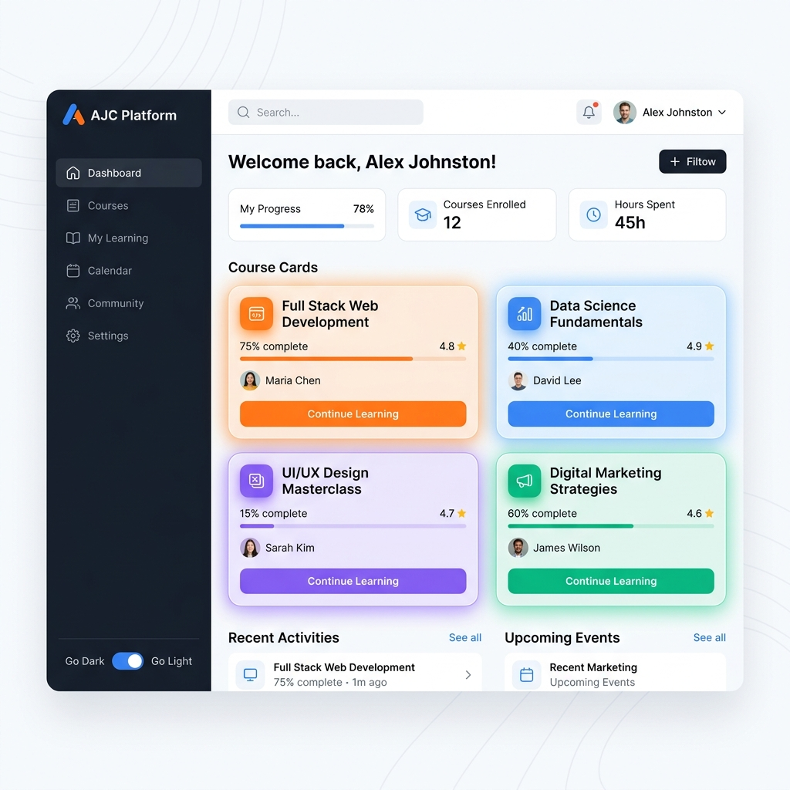
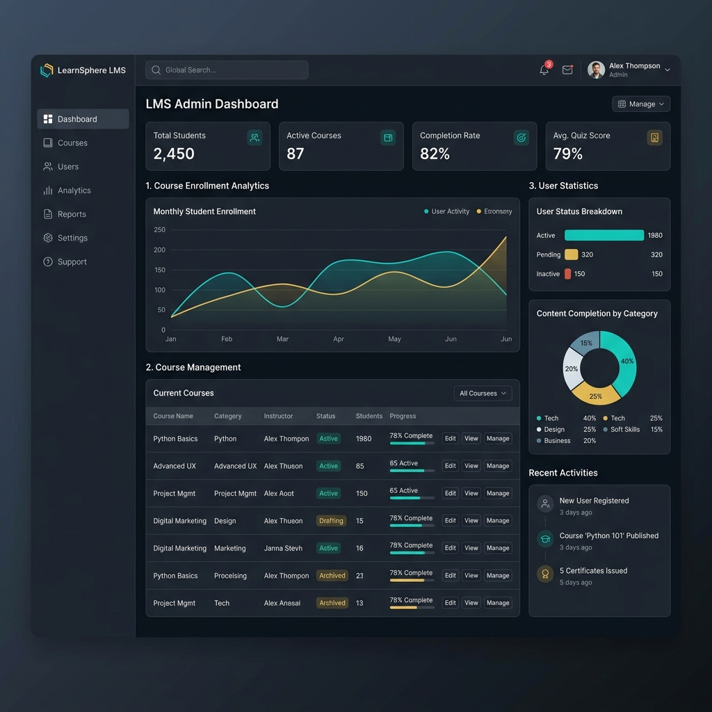

  <h1>🎓 AJC Platform</h1>
  
<strong>An Offline-ready Learning Management Platform with InsForge Integration</strong>

  
  
  

 

Welcome to the **AJC Platform**, a modern, offline-capable learning management system designed for seamless educational experiences.

---

## 🖥️ The Website Interface

The front-facing website is designed with a heavy focus on student experience. It features a beautiful, clean UI with dynamic light and dark mode toggling.

  

### How It Works:
- **Offline-First Architecture:** The platform uses advanced service workers and caching mechanisms to ensure that students can continue learning even when they lose their internet connection.
- **Course Progression:** Students can browse through their enrolled courses, dive into specific units, and complete chapters systematically.
- **Real-time Sync:** Powered by InsForge, any progress made offline is automatically synchronized with the cloud database the moment a connection is re-established.
- **Glassmorphism Design:** The interface utilizes sleek translucent elements and vibrant colors to create an engaging learning environment.

---

## ⚙️ The Admin Panel

The administrative backend of the platform is built for complete control over the learning experience.

  

### How It Works:
- **Comprehensive Analytics:** Administrators can view detailed statistics on user engagement, course completion rates, and overall platform health in real-time.
- **Content Management System (CMS):** A powerful data-table interface allows admins to seamlessly create, edit, or delete courses, units, and chapters.
- **User Management:** Monitor student sign-ups and assign roles instantly.
- **Secure Access (RLS):** Protected by InsForge's Row Level Security (RLS). Only authenticated users with the exact `admin` role assigned in their secure JWT can access or modify this data. 

---

## 🛠️ Technology Stack

- **Core:** HTML5, CSS3 (Vanilla), JavaScript (ES6+)
- **Build Tool:** Vite / Serve
- **Backend:** InsForge SDK (PostgreSQL, Realtime, Functions)
- **Typography:** Google Fonts (Inter)

---

## 🔒 Copyright & License

> [!CAUTION]
> **All Rights Reserved.**
> 
> This repository contains proprietary educational logic, UI designs, and backend configuration. It is strictly private property. No part of this codebase may be reproduced, distributed, or transmitted in any form or by any means without the prior written permission of the owner.
> 
> © 2026 Manomoy. All rights reserved.
